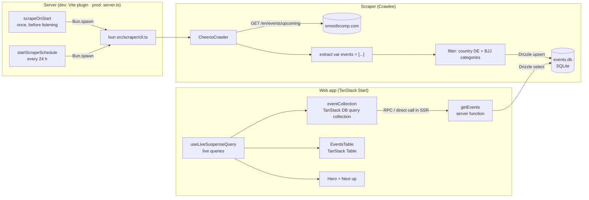

# Mat Calendar (smooth-scraper)

A demo that scrapes upcoming **Brazilian Jiu-Jitsu competitions in Germany**
from [Smoothcomp](https://smoothcomp.com/en/events/upcoming), stores them in
SQLite, and shows them in a server-rendered web app. The visual style uses the
colours and fonts of [academiabraunschweig.de](https://academiabraunschweig.de/).

The server scrapes fresh data **every time it starts** and then **every 24
hours** while it runs, both in development and in production.

---

## Contents

- [Quick start](#quick-start)
- [Detailed setup](#detailed-setup)
- [Scripts](#scripts)
- [Configuration](#configuration)
- [Architecture](#architecture)
- [Project structure](#project-structure)
- [Tech stack](#tech-stack)
- [Troubleshooting](#troubleshooting)
- [Known limitations](#known-limitations)

---

## Quick start

```sh
bun install
bun run dev        # scrapes smoothcomp.com, then serves http://localhost:3100
```

Open <http://localhost:3100>.

---

## Detailed setup

### 1. Prerequisites

| Requirement     | Version used   | Notes                                                          |
| --------------- | -------------- | -------------------------------------------------------------- |
| [Bun][bun]      | 1.4.5          | Required. The app uses `bun:sqlite`, `Bun.serve`, `Bun.spawn`. |
| Internet access | –              | The server fetches `smoothcomp.com` on start.                  |
| OS              | macOS or Linux | Windows is not tested.                                         |

Node.js is **not** needed. Every command runs on Bun, including Vite.

Check your Bun version:

```sh
bun --version
```

### 2. Install the dependencies

```sh
bun install
```

### 3. Start the development server

```sh
bun run dev
```

The command does these steps in order:

1. A Vite plugin (`scrapeOnDevStart` in `vite.config.ts`) runs the scraper as a
   child process: `bun src/scraper/cli.ts`.
2. The scraper fetches the Smoothcomp page and writes the events to
   `events.db`. This takes approximately 2–5 seconds. If the file does not
   exist, the scraper creates it.
3. Vite opens port **3100** and serves the app with hot reload.
4. A timer rescrapes every 24 hours (see
   [Scheduled rescrape](#2-scrape-on-start-and-on-a-schedule-srcscraperon-startts)).

Expected output:

```text
[scrape] startup: fetching events from smoothcomp.com …
[scrape] startup: Saved 32 events to events.db (4.6s)
[scrape] rescraping every 24 h

  VITE v8.4.0  ready in 5288 ms
  ➜  Local:   http://localhost:3100/
```

If the scrape fails (for example, when there is no network), the server
starts anyway and shows the data that is already in `events.db`. If the
database is empty, the page shows a "No data yet" card.

### 4. Build and run for production

```sh
bun run build      # Vite builds dist/client (browser) and dist/server (SSR)
bun run start      # scrapes, then serves dist/ with Bun.serve on port 3100
```

`server.ts` is the production server. It does these steps in order:

1. It stops with an error if `dist/` does not exist.
2. It runs the same scrape-on-start step as the development server, then
   starts the 24-hour rescrape timer.
3. It serves the files in `dist/client` (hashed assets get a one-year
   immutable cache header).
4. It sends every other request to the TanStack Start SSR handler in
   `dist/server/server.js`.

### 5. Optional: use the scraper without the web app

```sh
bun run scrape     # fetch and upsert into events.db
bun run show       # print the stored events as a table in the terminal
```

---

## Scripts

| Script              | Command                                        | What it does                                       |
| ------------------- | ---------------------------------------------- | -------------------------------------------------- |
| `bun run dev`       | `bunx --bun vite dev --port 3100 --strictPort` | Scrape, then start the dev server with hot reload. |
| `bun run build`     | `bunx --bun vite build`                        | Build the client and SSR bundles into `dist/`.     |
| `bun run start`     | `bun server.ts`                                | Scrape, then serve the production build.           |
| `bun run scrape`    | `bun src/scraper/cli.ts`                       | Run the scraper once.                              |
| `bun run show`      | `bun src/scraper/show.ts`                      | Print the stored events.                           |
| `bun run typecheck` | `tsc --noEmit`                                 | Type-check the project.                            |
| `bun run lint`      | `eslint`                                       | Lint the project.                                  |
| `bun run format`    | `prettier --write .`                           | Format the project.                                |

---

## Configuration

| Variable                | Default | Used by         | Effect                                                                                                                              |
| ----------------------- | ------- | --------------- | ----------------------------------------------------------------------------------------------------------------------------------- |
| `PORT`                  | `3100`  | `bun run start` | Port of the production server. The dev port is set in `package.json`.                                                               |
| `SCRAPE_INTERVAL_HOURS` | `24`    | `dev`, `start`  | Hours between scheduled rescrapes. Decimals are allowed (`0.5` = 30 minutes). An invalid value logs a warning and falls back to 24. |
| `SKIP_SCRAPE`           | unset   | `dev`, `start`  | Set to `1` to turn off the scrape on start **and** the schedule, and use the existing `events.db`.                                  |

Example: restart quickly without fetching again:

```sh
SKIP_SCRAPE=1 bun run dev
```

The database file is `events.db` in the project root. It is in `.gitignore`.
Delete it to start with an empty database. The next start creates it again.

---

## Architecture



### 1. Scraper: `src/scraper/`

- **Source.** The page `https://smoothcomp.com/en/events/upcoming` contains
  all upcoming events worldwide (approximately 1,500) as a JavaScript variable
  `var events = [...]`. The list has no pagination. The `?country=DE` query
  parameter does not filter this list.
- **Fetch.** A Crawlee [`CheerioCrawler`][crawlee-cheerio] downloads the page
  with up to 2 retries. HTTP/2 is turned off in a `preNavigationHook`, because
  the HTTP/2 agent of got-scraping fails under Bun.
- **Parse.** `extractEvents()` finds the JSON array in the HTML and parses
  only that array.
- **Filter.** The scraper keeps events where:
  - `location_country === "DE"`, and
  - `categoryGroups` contains a Jiu-Jitsu group: `1` = Jiu-Jitsu (Gi),
    `3`, `4`, `7` = Jiu-Jitsu (NoGi). These ids come from the category list on
    the Smoothcomp page.
- **Clean.** Postal codes are removed from city names
  (`63743 Aschaffenburg` → `Aschaffenburg`).
- **Store.** Rows are upserted by Smoothcomp event id in one transaction
  with [Drizzle ORM][drizzle-bun] on [`bun:sqlite`][bun-sqlite]. When you run
  the scraper again, existing rows are updated, not duplicated. The scraper
  does not delete events that are no longer listed. The app filters out past
  events instead.
- **Schema.** `src/scraper/db.ts` defines the `events` table: `id`, `title`,
  `url`, `start_date`, `end_date`, `city`, `country`, `lat`, `lng`,
  `cover_image`, `scraped_at`. For this demo, `openDb()` creates the table
  with `CREATE TABLE IF NOT EXISTS` instead of migrations.

### 2. Scrape on start and on a schedule: `src/scraper/on-start.ts`

Both functions run the scraper CLI as a **child process** and wait for it to
finish.

| Function                | When                                                         | Effect                                                                              |
| ----------------------- | ------------------------------------------------------------ | ----------------------------------------------------------------------------------- |
| `scrapeOnStart()`       | Once, before the server listens                              | The first request already sees fresh data.                                          |
| `startScrapeSchedule()` | After startup, then every 24 hours (`SCRAPE_INTERVAL_HOURS`) | Updates `events.db` while the server runs. Returns a function that stops the timer. |

Two places call them:

| Mode        | Caller                                            | When                                                                                                                        |
| ----------- | ------------------------------------------------- | --------------------------------------------------------------------------------------------------------------------------- |
| Development | Vite plugin `scrapeOnDevStart` (`vite.config.ts`) | In `configureServer`. Vite waits for the first scrape before it opens the port. The timer stops when the dev server closes. |
| Production  | `server.ts`                                       | Before `Bun.serve` starts. The timer runs until the process ends.                                                           |

Behaviour of the schedule:

- **Upsert only.** Each run updates existing rows and adds new ones. It does
  not delete events that disappeared from Smoothcomp. The page hides past
  events.
- **No overlap.** If a scrape is still running when the timer fires, the new
  run is skipped and a warning is logged.
- **Failures are harmless.** Every error (spawn failure, network error,
  non-zero exit code) is logged, `events.db` stays as it was, and the next run
  tries again.
- **The timer does not keep the process alive.** It is `unref`'d.
- **The server reads the database on every request.** A rescrape needs no
  restart. A page that is already open shows the new data after a reload.

A child process is used for two reasons:

- Crawlee stays out of the Vite config bundle and the SSR bundle.
- A crash in the scraper cannot stop the web server.

### 3. Server data access: `src/server/events.ts`

`getEvents` is a TanStack Start [server function][start-server-fns]. It reads
all rows from `events.db` with Drizzle, sorted by start date. The function
body runs only on the server. The browser bundle gets an RPC stub, so neither
`bun:sqlite` nor Drizzle reaches the client (the build confirms this).

### 4. Client data layer: `src/lib/collections.ts` and `src/router.tsx`

- `eventCollection` is a [TanStack DB][db] collection descriptor made with
  [`queryCollectionOptions`][db-query-collection]. Its `queryFn` calls
  `getEvents()`.
- `getRouter()` creates a new `QueryClient` and a new `DbClient` **for each
  request** on the server, and one of each in the browser. This keeps request
  data separate during SSR.
- [`routerWithDbClient`][db-ssr] (`@tanstack/react-router-with-db`) puts the
  `DbClient` into the router context, wraps the app in `DbProvider`, and
  streams live-query results from the server to the browser.

### 5. Rendering: `src/routes/index.tsx`

- The page uses [`useLiveSuspenseQuery`][db-live-queries] twice:
  - All upcoming events (`endDate >= today`) for the hero numbers and the
    "Next up" card.
  - The events in the selected time window (All / 30 days / 3 months) for the
    table. The window is a `where(lte(startDate, …))` clause in the live
    query.
- **Request lifecycle:**
  1. The server renders the page. The live queries suspend, the query
     collection calls `getEvents()` directly, and the results are streamed
     into the HTML.
  2. The browser hydrates from the streamed snapshot, so it does not show a
     loading state.
  3. The browser starts its own collection sync, which calls `getEvents()`
     through RPC, and switches to the live result.
- A change of the time window runs in `startTransition`, so the old table
  stays visible until the new result is ready.
- Dates are calculated in the `Europe/Berlin` time zone and formatted with
  fixed month and day names (`src/lib/dates.ts`). `Intl` is not used, because
  the ICU data in Bun and in browsers is different (for example "Sep" and
  "Sept"), which causes hydration errors.

### 6. Table: `src/components/events-table.tsx`

[TanStack Table v9][table] with these features:

- `rowSortingFeature` with `sortedRowModel`: click a column header to sort.
  The default sort is by date, ascending.
- `columnFilteringFeature` and `globalFilteringFeature` with
  `filteredRowModel`: the search box filters the title and city columns
  (`includesString`).
- Cells: date chip, title with organizer (from the Smoothcomp subdomain, for
  example `grapplingindustries`), city, a countdown badge (red when the event
  is 7 days away or less), and a link to the event.

### 7. Styling: `src/styles.css`

[shadcn/ui][shadcn] components (Button, Input, Badge, Table, ToggleGroup) on
[Base UI][base-ui] and [Tailwind CSS v4][tailwind] (shadcn style `base-nova` in `components.json`). The shadcn theme tokens use
the colours of academiabraunschweig.de:

| Token                | Value     | Original name on the site |
| -------------------- | --------- | ------------------------- |
| `--background`       | `#f4f5f2` | `--matte` (mat)           |
| `--card`             | `#ffffff` | `--flaeche` (surface)     |
| `--border`           | `#dcdfd9` | `--kante` (edge)          |
| `--foreground`       | `#15161a` | `--kreide` (chalk)        |
| `--muted-foreground` | `#5a5e66` | `--staub` (dust)          |
| `--primary`          | `#e03a26` | `--rot` (red mat circle)  |
| `--primary-deep`     | `#bd2c1a` | `--rot-tief` (deep red)   |
| `--ring` / `--gold`  | `#a8750f` | `--gold` (focus outline)  |

The fonts are Barlow (body text) and Barlow Condensed (uppercase headings),
from [Fontsource][fontsource-barlow] and served by the app itself. Buttons
are pill-shaped and the corner radius is 16px. There is no dark mode, the
same as on the original site.

---

## Project structure

```text
.
├── server.ts                    # production server: scrape → Bun.serve(dist)
├── vite.config.ts               # Vite + TanStack Start + Tailwind + scrape-on-dev-start plugin
├── components.json              # shadcn/ui configuration
├── events.db                    # SQLite database (created at runtime, git-ignored)
└── src
    ├── scraper
    │   ├── scrape.ts            # scrapeEvents(): Crawlee → filter → Drizzle upsert
    │   ├── cli.ts               # `bun run scrape` entry point
    │   ├── on-start.ts          # scrapeOnStart() + startScrapeSchedule() for dev and prod
    │   ├── db.ts                # Drizzle schema + openDb() on bun:sqlite
    │   └── show.ts              # `bun run show`: print stored events
    ├── server
    │   └── events.ts            # getEvents server function
    ├── lib
    │   ├── collections.ts       # TanStack DB query collection
    │   ├── dates.ts             # time-zone-safe date helpers
    │   └── utils.ts             # cn() class name helper
    ├── router.tsx               # router + QueryClient + DbClient for each request
    ├── routes
    │   ├── __root.tsx           # HTML shell, header, footer, devtools
    │   └── index.tsx            # page: hero, filters, live queries
    ├── routeTree.gen.ts         # generated by TanStack Router, do not edit
    ├── components
    │   ├── events-table.tsx     # TanStack Table
    │   ├── site-chrome.tsx      # header and footer
    │   └── ui/                  # shadcn/ui components
    └── styles.css               # Tailwind + theme tokens
```

---

## Tech stack

### Runtime and tooling

| Technology | Version | Used for                                                         | Docs                                                                                             |
| ---------- | ------- | ---------------------------------------------------------------- | ------------------------------------------------------------------------------------------------ |
| Bun        | 1.4.5   | Runtime, package manager, `bun:sqlite`, `Bun.serve`, `Bun.spawn` | [Bun docs][bun] · [SQLite][bun-sqlite] · [HTTP server][bun-serve] · [Child processes][bun-spawn] |
| TypeScript | 6.0     | Types                                                            | [TypeScript docs](https://www.typescriptlang.org/docs/)                                          |
| Vite       | 8.4     | Dev server and bundler (TanStack Start needs it)                 | [Vite guide](https://vite.dev/guide/) · [Plugin API](https://vite.dev/guide/api-plugin)          |
| ESLint     | 10      | Linting (`@tanstack/eslint-config`)                              | [ESLint docs](https://eslint.org/docs/latest/)                                                   |
| Prettier   | 3.10    | Formatting (with the Tailwind plugin)                            | [Prettier docs](https://prettier.io/docs/)                                                       |

### Scraping and storage

| Technology  | Version    | Used for                              | Docs                                                                                                                                                               |
| ----------- | ---------- | ------------------------------------- | ------------------------------------------------------------------------------------------------------------------------------------------------------------------ |
| Crawlee     | 3.18       | `CheerioCrawler`: fetch, retry, parse | [Quick start](https://crawlee.dev/js/docs/quick-start) · [CheerioCrawler guide](https://crawlee.dev/js/docs/guides/cheerio-crawler-guide) · [API][crawlee-cheerio] |
| SQLite      | (from Bun) | Database file `events.db`             | [SQLite docs](https://www.sqlite.org/docs.html)                                                                                                                    |
| Drizzle ORM | 0.45       | Schema, typed queries, upsert         | [Overview](https://orm.drizzle.team/docs/overview) · [Bun SQLite driver][drizzle-bun] · [Insert / upsert](https://orm.drizzle.team/docs/insert)                    |

### Web app

| Technology                   | Version    | Used for                                                                                          | Docs                                                                                                                                                                                                                                                                                              |
| ---------------------------- | ---------- | ------------------------------------------------------------------------------------------------- | ------------------------------------------------------------------------------------------------------------------------------------------------------------------------------------------------------------------------------------------------------------------------------------------------- |
| React                        | 19.3       | UI, Suspense, transitions                                                                         | [React reference](https://react.dev/reference/react) · [Suspense](https://react.dev/reference/react/Suspense)                                                                                                                                                                                     |
| TanStack Start               | 1.169      | Full-stack framework, SSR, server functions                                                       | [Overview](https://tanstack.com/start/latest/docs/framework/react/overview) · [Server functions][start-server-fns] · [Hosting](https://tanstack.com/start/latest/docs/framework/react/guide/hosting)                                                                                              |
| TanStack Router              | 1.170      | File-based routing, router context                                                                | [Overview](https://tanstack.com/router/latest/docs/framework/react/overview) · [File-based routing](https://tanstack.com/router/latest/docs/framework/react/routing/file-based-routing)                                                                                                           |
| TanStack DB                  | 1.0.0-rc.1 | Collections, live queries, SSR streaming (`@tanstack/react-db`, `@tanstack/react-router-with-db`) | [Overview][db] · [Live queries][db-live-queries] · [SSR and hydration][db-ssr]                                                                                                                                                                                                                    |
| TanStack DB Query Collection | 1.5        | Collection that loads data with a TanStack Query `queryFn`                                        | [Query collection][db-query-collection]                                                                                                                                                                                                                                                           |
| TanStack Query (core)        | 5.108      | `QueryClient` for the query collection                                                            | [Overview](https://tanstack.com/query/latest/docs/framework/react/overview)                                                                                                                                                                                                                       |
| TanStack Table               | 9.3        | Headless table: sorting, global search                                                            | [Overview][table] · [Sorting](https://tanstack.com/table/latest/docs/framework/react/guide/sorting) · [Global filtering](https://tanstack.com/table/latest/docs/framework/react/guide/global-filtering) · [Table state](https://tanstack.com/table/latest/docs/framework/react/guide/table-state) |
| TanStack Devtools            | latest     | Router devtools panel in development                                                              | [Overview](https://tanstack.com/devtools/latest/docs/overview)                                                                                                                                                                                                                                    |

### UI and styling

| Technology               | Version | Used for                                                                                                                            | Docs                                                                                                                                        |
| ------------------------ | ------- | ----------------------------------------------------------------------------------------------------------------------------------- | ------------------------------------------------------------------------------------------------------------------------------------------- |
| shadcn/ui                | 4.23    | Copy-in components (`src/components/ui`)                                                                                            | [Docs][shadcn] · [TanStack Start install](https://ui.shadcn.com/docs/installation/tanstack) · [Theming](https://ui.shadcn.com/docs/theming) |
| Base UI                  | 1.9     | Unstyled, accessible primitives under shadcn (Button, Input, Toggle, ToggleGroup). Links use the `render` prop instead of `asChild` | [Quick start][base-ui] · [Composition (`render` prop)](https://base-ui.com/react/handbook/composition)                                      |
| Tailwind CSS             | 4.3     | Utility CSS, `@theme` tokens                                                                                                        | [Docs][tailwind] · [Theme variables](https://tailwindcss.com/docs/theme)                                                                    |
| class-variance-authority | 0.7     | Component variants (buttons, badges)                                                                                                | [Docs](https://cva.style/docs)                                                                                                              |
| Lucide                   | 1.81    | Icons                                                                                                                               | [lucide-react](https://lucide.dev/guide/packages/lucide-react)                                                                              |
| Fontsource               | 5.3     | Self-hosted Barlow and Barlow Condensed                                                                                             | [Barlow][fontsource-barlow] · [Barlow Condensed](https://fontsource.org/fonts/barlow-condensed)                                             |

---

## Troubleshooting

**`Port 3100 is in use`**
The dev server uses `--strictPort`, so it stops instead of moving to a
different port. Stop the other process, or change the port in the `dev`
script. For production, set `PORT`:
`PORT=4000 bun run start`.

**`[scrape] failed, serving existing events.db`**
The scraper could not fetch Smoothcomp. The log shows the error. Look for:

- no network connection,
- Smoothcomp is down or blocks the request,
- the page layout changed. In that case the log shows
  ``"`var events` not found - page layout changed?"``. Update
  `extractEvents()` in `src/scraper/scrape.ts`.

Run `bun run scrape` to see the full Crawlee log.

**The page shows "No data yet"**
`events.db` is empty. Run `bun run scrape`, then reload the page.

**`Requested origin https://smoothcomp.com does not match server`**
This is the got-scraping HTTP/2 failure under Bun. The crawler turns HTTP/2
off in `preNavigationHooks`. Keep that hook.

**`Cannot find module 'bun:sqlite'` or a similar error in development**
Vite ran under Node.js instead of Bun. Start it with `bun run dev`, which
uses `bunx --bun vite`, and not with `npx vite` or `vite`.

**Hydration warning about a date or month name**
Do not use `Intl.DateTimeFormat` or `toLocaleDateString` for text that is
rendered on the server. Use the helpers in `src/lib/dates.ts`.

**`dist/ is missing. Run \`bun run build\` first.`**
`bun run start`needs a build. Run`bun run build` first.

---

## Known limitations

- The data is refreshed when the server starts and then every 24 hours. The
  schedule is a timer inside the server process: it restarts from zero with
  each restart, and it does not run if the server is stopped. Run
  `bun run scrape` for an immediate refresh. An open browser tab does not poll;
  it shows the new data after a reload.
- If you run more than one server process on the same `events.db`, each one
  scrapes on its own. SQLite handles the writes, but the work is repeated.
- The BJJ filter uses Smoothcomp category ids `1, 3, 4, 7`. Some
  multi-discipline events and seminars can be included.
- The table is created with `CREATE TABLE IF NOT EXISTS`, not with Drizzle
  Kit migrations. If you change the schema, delete `events.db`.
- TanStack DB and `@tanstack/react-router-with-db` are release candidates.
  Their APIs can change.
- The project instructions in `AGENTS.md` say to use Bun's bundler instead of
  Vite. TanStack Start requires Vite, so Vite is used, but it runs on Bun.

[bun]: https://bun.com/docs
[bun-sqlite]: https://bun.com/docs/runtime/sqlite
[bun-serve]: https://bun.com/docs/runtime/http/server
[bun-spawn]: https://bun.com/docs/runtime/child-process
[crawlee-cheerio]: https://crawlee.dev/js/api/cheerio-crawler/class/CheerioCrawler
[drizzle-bun]: https://orm.drizzle.team/docs/connect-bun-sqlite
[start-server-fns]: https://tanstack.com/start/latest/docs/framework/react/guide/server-functions
[db]: https://tanstack.com/db/latest/docs/overview
[db-query-collection]: https://tanstack.com/db/latest/docs/collections/query-collection
[db-live-queries]: https://tanstack.com/db/latest/docs/guides/live-queries
[db-ssr]: https://tanstack.com/db/latest/docs/guides/ssr
[table]: https://tanstack.com/table/latest/docs/overview
[shadcn]: https://ui.shadcn.com/docs
[base-ui]: https://base-ui.com/react/overview/quick-start
[tailwind]: https://tailwindcss.com/docs
[fontsource-barlow]: https://fontsource.org/fonts/barlow
